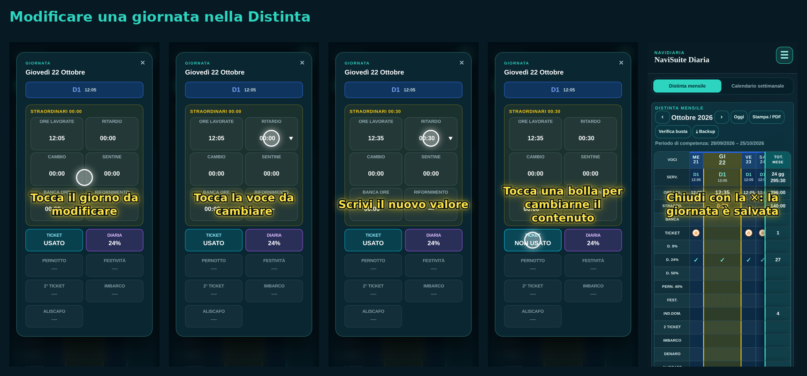
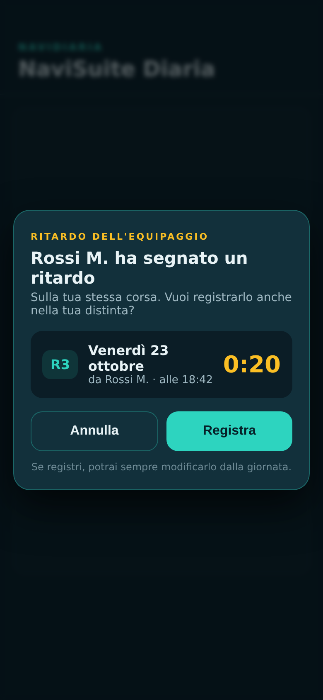
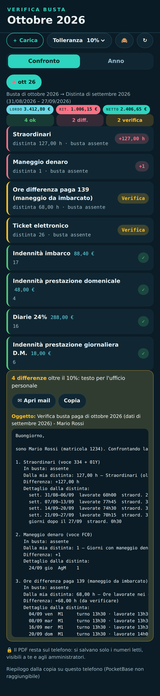
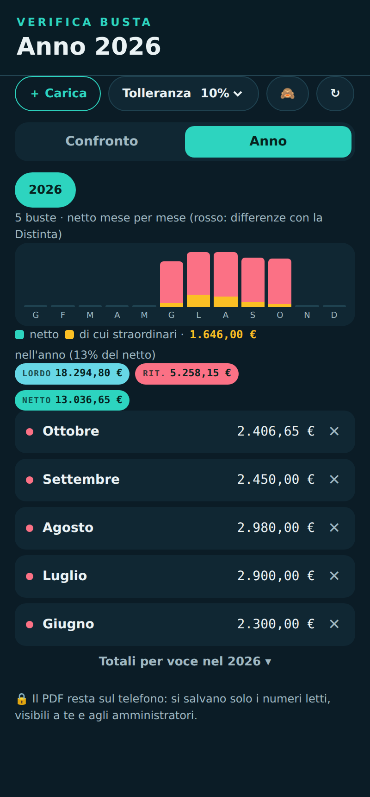
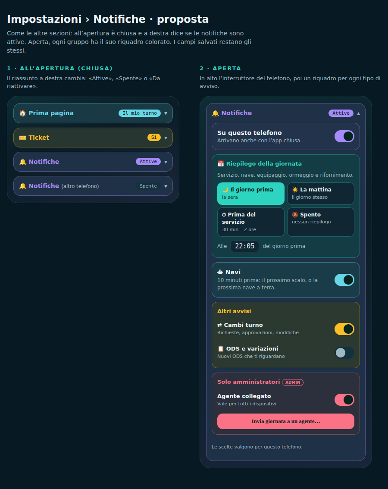
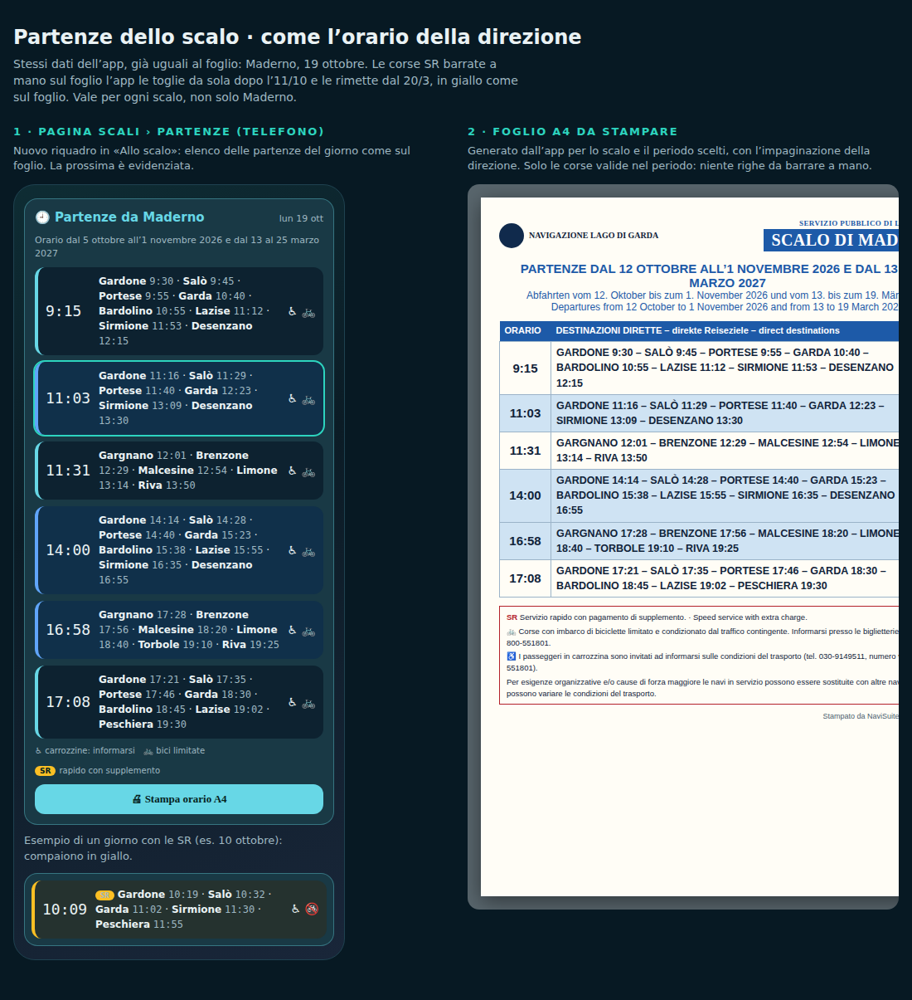
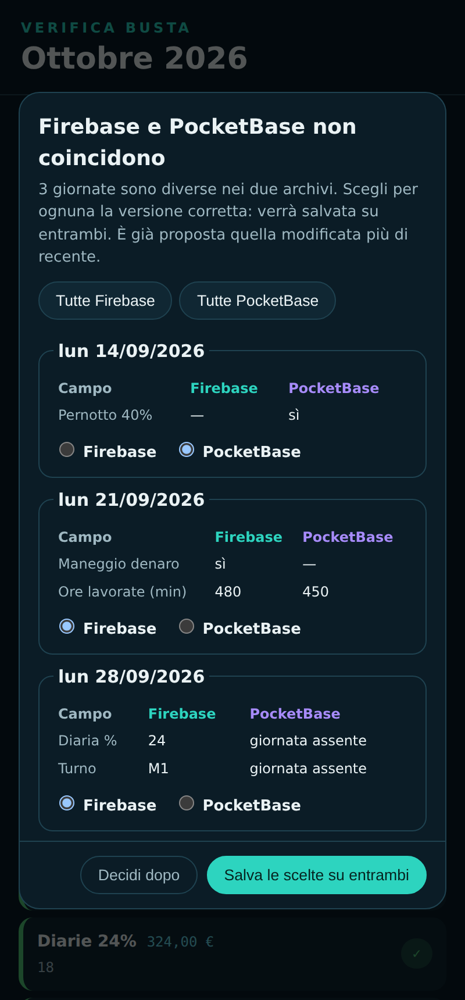

# 📘 Guida Avanzata a NaviSuite

Questa guida approfondisce tutte le funzioni avanzate di **NaviSuite**: dal calcolo dettagliato della Distinta e il controllo automatico della busta paga, fino agli avvisi a telefono bloccato, il calendario sincronizzato, il widget per iPhone e la mappa in tempo reale degli scali.

> 💡 *Sei alle prime armi? Inizia prima dalla [**🚀 Guida Rapida (2 minuti)**](GUIDA-RAPIDA.md).*

---

## Indice

1. [Distinta (`NaviDiaria`): Funzioni Avanzate e Calcolo Ore](#1-distinta-navidiaria-funzioni-avanzate-e-calcolo-ore)
2. [Verifica Busta Paga e Statistiche Annuali](#2-verifica-busta-paga-e-statistiche-annuali)
3. [Notifiche Push a Telefono Bloccato](#3-notifiche-push-a-telefono-bloccato)
4. [Scali in Tempo Reale, Mappa del Lago e Stampe A4](#4-scali-in-tempo-reale-mappa-del-lago-e-stampe-a4)
5. [Sincronizzazione automatica col Calendario (iPhone e Android)](#5-sincronizzazione-automatica-col-calendario-iphone-e-android)
6. [Widget per iPhone (Schermata Home e Blocco Schermo)](#6-widget-per-iphone-schermata-home-e-blocco-schermo)
7. [Personalizzazione del Menu e Pagina Iniziale](#7-personalizzazione-del-menu-e-pagina-iniziale)
8. [Controllo Cassa, Comitive e Documenti O.d.S.](#8-controllo-cassa-comitive-e-documenti-ods)
9. [Backup, Allineamento Archivi e Uso Offline](#9-backup-allineamento-archivi-e-uso-offline)

---

## 1. Distinta (`NaviDiaria`): Funzioni Avanzate e Calcolo Ore

La sezione **Distinta** non è un semplice foglio di appunti: applica automaticamente le regole del CCNL e degli accordi aziendali per calcolare ore, straordinari e indennità del periodo di competenza.

### Come funziona il calcolo
* **Periodo di competenza e settimane a 39 ore**: la distinta mensile considera le settimane del periodo di competenza (indicate sotto il mese, es. *28/09/2026 – 25/10/2026*), gestendo in automatico anche le settimane a cavallo tra due mesi.
* **Ricalcolo istantaneo**: quando tocchi una giornata e modifichi una voce (*Ritardo*, *Cambio*, *Sentine*, *Banca ore*, *Rifornimento*), NaviSuite aggiorna in tempo reale sia le **Ore lavorate** del giorno sia gli **Straordinari** settimanali e mensili.

  

### Ritardo condiviso con l'equipaggio
Se un collega che naviga **sulla tua stessa corsa/nave** registra un ritardo nella propria distinta, quando apri NaviSuite ti comparirà un avviso automatico:

  

* Premendo **Registra**, quel ritardo viene inserito con un solo tocco anche nella tua giornata (potrai comunque modificarlo in qualsiasi momento).
* Premendo **Annulla**, l'avviso viene ignorato.

### Stampa / PDF della Distinta
In alto a destra sopra la tabella mensile puoi premere **Stampa / PDF** per generare il foglio riepilogativo mensile pronto da stampare o salvare sul telefono.

---

## 2. Verifica Busta Paga e Statistiche Annuali

Dalla **Distinta** (pulsante **Verifica busta**) oppure dal menu **`☰` → Verifica busta (`✔`)** puoi controllare in pochi secondi se il cedolino paga corrisponde a quanto hai segnato nella tua distinta.

> [!NOTE]
> **Privacy garantita**: il file PDF della busta paga viene letto direttamente dal tuo telefono; il documento PDF non viene caricato online ma restano salvati solo i valori numerici estratti per il tuo riepilogo.

### Confronto Mese per Mese e Mail per l'Ufficio Personale
1. Premi **`+ Carica`** e seleziona il PDF della busta paga ricevuto dall'azienda.
2. NaviSuite abbina automaticamente le competenze della busta (che si riferiscono al mese precedente) con la tua **Distinta di quel periodo**:
   * **In verde (`ok`)**: le voci che coincidono (entro la percentuale di tolleranza scelta, es. 10%).
   * **In rosso (`diff.`)**: le voci in cui c'è una differenza tra la tua distinta e la busta paga (es. ore di straordinario mancanti, maneggio denaro, diarie).
   * **In giallo (`verifica`)**: le voci particolari da controllare (es. differenza paga, ticket).
3. Se ci sono differenze, in fondo alla pagina NaviSuite **scrive già per te il testo completo della segnalazione** con l'elenco dettagliato dei giorni e dei turni! Ti basta premere **Apri mail** o **Copia** per inviarlo all'Ufficio Personale:

  

### Vista Annuale (`Anno`)
Passando alla scheda **Anno**, hai un quadro completo di tutti i cedolini caricati nell'anno:
* Grafico dell'andamento del netto mese per mese (con indicazione della quota derivante dagli straordinari).
* Totali annui di **Lordo**, **Ritenute**, **Netto**, **13ª**, **14ª**, **TFR** e dettaglio voce per voce.

  

---

## 3. Notifiche Push a Telefono Bloccato

NaviSuite può inviarti avvisi automatici sul telefono anche quando l'app è chiusa.
Per attivarli vai in **`☰` → Impostazioni (`⚙`) → Notifiche**:

  

1. Accendi l'interruttore **Su questo telefono** (e consenti le notifiche quando il telefono lo chiede).
2. Scegli quali avvisi ricevere:
   * **📅 Riepilogo della giornata**: ricevi un promemoria con il tuo servizio, la nave, l'equipaggio, l'ormeggio serale e il rifornimento. Puoi scegliere se riceverlo **la sera prima** (all'orario che preferisci, es. `22:05`), **la mattina stessa** oppure **da 30 minuti a 2 ore prima dell'inizio del servizio**.
   * **⛴ Navi (10 minuti prima)**:
     * **Se sei di servizio a terra** (`AgB`, `PonD`, `AgM`, `AgT`…): 10 minuti prima dell'arrivo ti avvisa con **nome nave, pontile, provenienza, numero corsa e comandante**.
     * **Se sei imbarcato a bordo** (`D1`, `P2`, `M1`, `T1`, `BIS`…): 10 minuti prima ti avvisa con **il prossimo scalo, l'orario, la corsa, il pontile a Desenzano e lo scalo successivo**.
     * *Gli avvisi tengono conto in tempo reale dei ritardi, delle corse sospese dall'Ufficio Movimento e dei BIS!*
   * **⇄ Cambi turno**: ti avvisa subito quando un collega ti manda una richiesta di cambio turno e quando l'ufficio la approva.
   * **📋 ODS e variazioni**: ti avvisa appena viene pubblicato un nuovo O.d.S. o una variazione dell'Ufficio Movimento che modifica un tuo turno futuro (es. `📋 ODS 40/26 · dom 11/10 — M1→RIP`).

---

## 4. Scali in Tempo Reale, Mappa del Lago e Stampe A4

Aprendo **`☰` → Scali (`⚓`)** hai sotto controllo l'intera rete del Lago di Garda:

* **Situazione allo scalo**: scegli uno scalo (es. *Desenzano*, *Maderno*, *Sirmione*, *Riva*…) per vedere le prossime navi in arrivo e in partenza, il pontile assegnato, l'equipaggio a bordo e gli eventuali minuti di ritardo.
* **Mappa del Lago in tempo reale**: visualizza la posizione stimata delle navi lungo le rotte del lago e lo stato dei pontili.
* **Partenze dallo scalo e Stampa A4**: nel riquadro delle partenze vedi tutte le corse della giornata con le destinazioni dirette e le note (servizio rapido `SR`, limitazioni biciclette, accessibilità). Premendo **Stampa orario A4** ottieni il foglio ufficiale impaginato in 3 lingue (italiano, tedesco, inglese) pronto da appendere in biglietteria o al pontile:

  

---

## 5. Sincronizzazione automatica col Calendario (iPhone e Android)

Vuoi vedere i tuoi turni direttamente nell'app **Calendario** dell'iPhone o in **Google Calendar** insieme ai tuoi impegni personali?

1. Apri **`☰` → Impostazioni (`⚙`) → Calendario personale**.
2. Premi **Attiva sincronizzazione**: NaviSuite genera un tuo collegamento personale sicuro (il tuo PIN non è mai contenuto nel link).
3. Premi **Aggiungi su iPhone** oppure **Aggiungi su Google** (oppure **Scarica `.ics`** per un'esportazione singola).

**Cosa troverai in ogni giornata sul calendario del telefono:**
* Nome del turno e orario di inizio/fine;
* Nave assegnata;
* Pontile di ormeggio serale ed eventuale rifornimento;
* Elenco completo dei colleghi d'equipaggio con le rispettive qualifiche.

Quando un tuo turno cambia per un O.d.S. o un cambio turno approvato, il calendario si aggiorna da solo!

---

## 6. Widget per iPhone (Schermata Home e Blocco Schermo)

Su iPhone puoi aggiungere un **widget gratuito** che mostra a colpo d'occhio la **prossima nave in arrivo al tuo scalo** (se sei a terra) oppure il **prossimo scalo** (se stai navigando), senza nemmeno sbloccare il telefono o aprire l'app.

1. Installa dall'App Store l'app gratuita **Scriptable**.
2. Apri questo collegamento dal telefono e copia tutto il testo:
   `https://raw.githubusercontent.com/PapaMike80/NaviSuite/main/tools/widget-iphone/NaviSuite-widget.js`
3. Apri **Scriptable** → tocca **`+`** in alto a destra → incolla il testo → rinomina in alto lo script in **`NaviSuite`** → premi **Fine**.
4. **Per metterlo sulla schermata Home**:
   * Tieni premuto uno spazio vuoto sulla Home → **Modifica** → **Aggiungi widget** → cerca **Scriptable** → scegli la dimensione e premi **Aggiungi widget**.
   * Tieni premuto sul widget appena creato → **Modifica widget**:
     * **Script**: scegli `NaviSuite`
     * **Parameter**: scrivi il tuo **cognome** (es. `Pedroni` o `Pedroni M.` in caso di omonimia, oppure il tuo numero di matricola/agente).
5. **Per metterlo anche sulla schermata di blocco**:
   * Tieni premuto sulla schermata bloccata → **Personalizza** → **Schermata di blocco** → tocca l'area dei widget sotto l'orologio → scegli **Scriptable** → toccalo e imposta Script = `NaviSuite` e Parameter = il tuo cognome.

---

## 7. Personalizzazione del Menu e Pagina Iniziale

### Riordinare le icone del menu `☰`
Puoi decidere tu quali pagine tenere in grande in alto e in quale ordine:

  

1. Apri il menu **`☰`** in alto a destra.
2. **Tieni premuta un'icona** per mezzo secondo finché si solleva.
3. **Trascinala** tra le pagine principali in alto o tra le *Altre pagine* in basso e rilascia il dito.
4. Se in futuro vuoi tornare alla disposizione standard, ti basta premere **Ripristina il menu** in basso nel menu.

### Scegliere la Prima Pagina di apertura
Quando apri NaviSuite dal telefono, l'app ti porta subito nella tua pagina preferita (senza passare ogni volta dalla schermata di scelta).

Per cambiarla:
1. Tocca il menu **`☰`** in alto a destra → **Impostazioni (`⚙`)**.
2. Tocca il riquadro azzurro **Prima pagina di apertura** (quando è chiuso mostra a destra la pagina attualmente attiva).
3. Tocca una delle pastiglie disponibili:
   * **Automatica** *(predefinita)*: apre **Il mio turno**, anche nei giorni di servizio a terra.
   * **Turni**: apre il calendario turni generale della residenza.
   * **Distinta**: apre subito *NaviDiaria* (giornate e competenze).
   * **Il mio turno**: nave, colleghi e scali di oggi.
   * **Oggi**: il quadro completo di navi ed equipaggi della giornata.
   * **Scali**: navi sul lago e allo scalo, pontili e ritardi.
   * **Documenti**: gli O.d.S. e i turni in PDF.
   * **Cambio**: le richieste di cambio turno.
   * **Home**: la panoramica con tutte le tessere dell'app.
4. La modifica viene **salvata automaticamente sul tuo profilo** (compare la scritta *"Salvato automaticamente sul tuo profilo"* in fondo alla pagina).

> 💡 **Nota per gli Amministratori**: all'interno dello stesso riquadro *Prima pagina di apertura* è presente anche il comando **Prima pagina per tutti gli agenti** (*Reset per tutti*), che permette di impostare una pagina iniziale predefinita per tutti i profili (lasciando poi a ciascun collega la libertà di ricambiarla).

---

## 8. Controllo Cassa, Comitive e Documenti O.d.S.

* **¤ Cassa (`controllo_cassa.html`)**: inserisci il numero di banconote e monete per ciascun taglio per ottenere all'istante il totale contato, la differenza rispetto al fondo cassa previsto e il riepilogo del versamento.
* **⛴ Comitive (`comitive.html`)**: consulta l'elenco dei gruppi turistici e delle comitive previste sulle corse del giorno (estratti dagli O.d.S. e dagli avvisi operativi), con indicazione di corsa, scalo di imbarco, scalo di sbarco e numero di passeggeri.
* **▤ Documenti (`documenti.html`)**: consulta in qualsiasi momento i PDF ufficiali pubblicati dall'azienda, divisi tra **Turni** e **O.d.S.** (Ordini di Servizio). I documenti non ancora definitivi sono chiaramente contrassegnati dall'etichetta **Bozza**.

---

## 9. Backup, Allineamento Archivi e Uso Offline

### Come funziona quando non c'è campo sul lago
NaviSuite salva sul telefono una copia degli ultimi turni e delle tue modifiche alla distinta:
* Se sei in mezzo al lago o in un punto senza rete, puoi comunque aprire i turni e compilare la distinta.
* Non appena il telefono ritrova la connessione, i dati vengono sincronizzati con l'archivio cloud.

> [!CAUTION]
> **Non cancellare i dati di navigazione / la cache del browser** mentre sei senza rete o se hai modifiche non ancora sincronizzate, altrimenti potresti perdere le ultime note salvate solo sul dispositivo.

### Allineamento Archivi
Se hai usato NaviSuite su due dispositivi diversi (es. telefono e PC di casa) o durante un passaggio tra archivi cloud e ci sono differenze su alcune giornate della distinta, NaviSuite ti mostra una schermata chiara di confronto:

  

Ti viene già preselezionata la versione modificata più di recente, ma puoi scegliere giornata per giornata quale mantenere e premere **Salva le scelte su entrambi**.

### Backup Personale (`Backup`)
Da **`☰` → Backup (`⤓`)** (oppure dal pulsante **Backup** nella Distinta) puoi scaricare in qualsiasi momento sul tuo telefono un file con tutte le tue distinte e impostazioni, o ricaricarlo in caso di cambio telefono.

---

## 🆘 Hai bisogno di aiuto?

Se qualcosa non funziona come previsto:
1. Premi il pulsante **Aggiorna** nella pagina o chiudi e riapri l'app.
2. Verifica di aver selezionato il tuo **nominativo corretto** e di non aver confuso il PIN.
3. Quando segnali un problema a un amministratore, indica **il tuo cognome**, **la pagina che stavi usando** e allega una **schermata dell'errore** *(attenzione: non inviare mai schermate in cui sia visibile il tuo PIN!)*.
