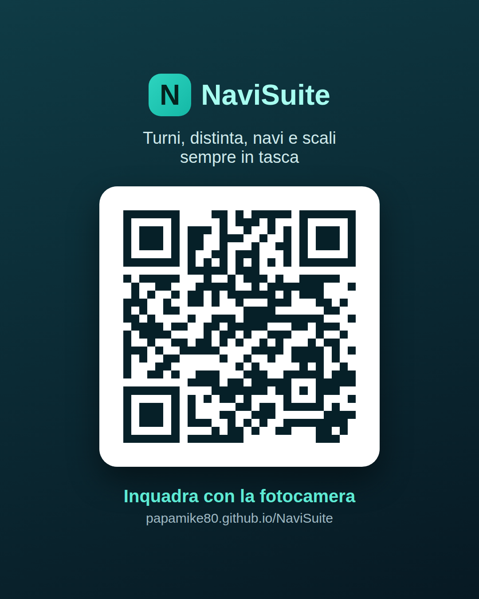
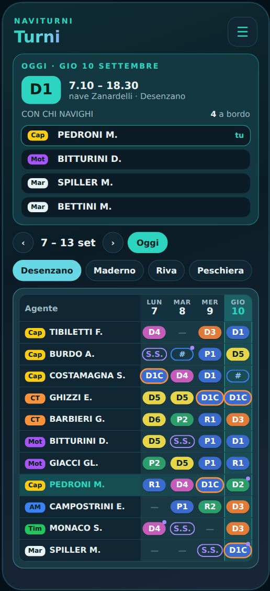

# 🚀 Guida Rapida a NaviSuite

Questa guida ti spiega **in 2 minuti** come entrare in **NaviSuite**, salvarla sul telefono come un'app e usare le funzioni di tutti i giorni.

---

## 1. Come aprire NaviSuite (e metterla sulla schermata Home)

Non serve scaricare nulla dagli store: apri il collegamento **`https://papamike80.github.io/NaviSuite`** oppure inquadra questo codice QR con la fotocamera del telefono:

  

> [!TIP]
> **Salvala come App sul telefono (consigliato):**
> * **Su iPhone (Safari)**: tocca il pulsante **Condividi** (il quadrato con la freccia in basso) → scorri e tocca **Aggiungi alla schermata Home**.
> * **Su Android (Chrome)**: tocca i **tre puntini `⋮`** in alto a destra → **Installa app** (oppure **Aggiungi a schermata Home**).
>
> *Usa sempre lo stesso telefono/browser così il tuo accesso resta memorizzato.*

---

## 2. Primo Accesso e PIN Personale

1. Tocca il campo **Cognome** e scrivi le prime lettere del tuo cognome.
2. Tocca il tuo **nome** dall'elenco che compare.
3. Inserisci il tuo **PIN personale** e premi **Accedi →**.

* **È la prima volta che entri?**
  * Usa il PIN iniziale **`1957`** (oppure premi **Non hai il PIN? Chiedi accesso** se sei appena entrato in servizio).
  * Subito dopo, NaviSuite ti chiederà di scegliere un **tuo PIN personale da 4 a 8 cifre** che userai da quel momento in poi.
* **Hai dimenticato il PIN?** Chiedi a un amministratore di azzerarlo: tornerà temporaneamente a `1957` e potrai sceglierne uno nuovo.

---

## 3. Le 5 pagine che userai ogni giorno

Appena entrato (oppure toccando il pulsante menu **`☰`** in alto a destra da qualsiasi pagina) trovi subito in grande le 5 sezioni principali:

| Icona | Pagina | A cosa serve |
| :---: | :--- | :--- |
| **≈** | **Distinta** | Segnare ore lavorate, ritardi, cambi, ticket, diaria e competenze del mese. |
| **⚑** | **Il mio turno** | Vedere subito con che nave esci oggi, le corse con gli orari, l'ormeggio serale e i colleghi a bordo. |
| **▦** | **Turni** | Consultare il tabellone generale dei turni di tutti gli agenti per residenza. |
| **☀** | **Oggi** | Vedere tutte le navi in linea oggi e gli equipaggi assegnati a bordo e a terra. |
| **⚓** | **Scali** | Controllare in tempo reale le navi in arrivo allo scalo, i pontili, i ritardi e la mappa del lago. |

---

## 4. Vedere il tuo turno e con chi navighi (`Turni` e `Il mio turno`)

Aprendo **Turni** o **Il mio turno**, NaviSuite riconosce automaticamente il tuo nome:

  

* In alto vedi **il tuo turno di oggi**, gli **orari di inizio e fine**, la **nave** e l'elenco completo dei **colleghi a bordo** con la loro qualifica (`Cap`, `CT`, `Tim`, `Mot`, `AM`, `Mar`, `App`).
* Sotto trovi il **tabellone settimanale** della tua residenza (*Desenzano*, *Maderno*, *Riva*, *Peschiera*): la tua riga è evidenziata.
* **Tocca qualsiasi casella** del tabellone per aprire i dettagli di quel turno, vedere l'equipaggio di quel giorno o eventuali variazioni da O.d.S.

---

## 5. Compilare la Distinta in pochi tocchi (`Distinta`)

La tua giornata lavorativa viene già pre-compilata in base al tuo turno. Se devi segnare un **ritardo**, un **cambio**, la **banca ore** o cambiare **ticket/diaria**:

  

  

1. **Tocca il giorno** nella tabella mensile per aprire la scheda della giornata.
2. **Tocca la casella che vuoi cambiare** (es. *Ritardo*, *Cambio*, *Sentine*, *Banca ore*, *Rifornimento*) e inserisci il valore: le **ore lavorate** e gli **straordinari** si ricalcolano da soli!
3. **Tocca le bolle colorate in basso** (*Ticket*, *Diaria*, *Pernotto*, *Festività*, *2° Ticket*, *Imbarco*) per attivarle o cambiarne la percentuale.
4. **Chiudi con la `✕` in alto a destra**: la giornata viene salvata automaticamente.

---

## 6. Cercare un Cambio Turno (`Cambio`)

1. Apri il menu **`☰`** e tocca **Cambio** (`⇄`).
2. Scegli il **giorno** che vorresti cambiare.
3. NaviSuite ti mostra automaticamente l'elenco dei **colleghi compatibili** per qualifica e riposi.
4. Tocca il collega, controlla il riepilogo delle date e premi **Invia richiesta**.

> [!IMPORTANT]
> L'invio della richiesta avvisa il collega e l'ufficio, ma **il cambio è valido solo dopo l'approvazione ufficiale dell'Ufficio Movimento**.

---

## 7. Scegliere la Prima Pagina all'apertura e riordinare il Menu

### 🏠 Scegliere quale pagina aprire subito quando entri in NaviSuite
Di base, quando apri NaviSuite si apre **Il mio turno**. Vuoi invece che si apra subito **Turni**, **Distinta**, **Scali** o **Oggi**?

1. Tocca il pulsante menu **`☰`** in alto a destra.
2. Tocca **Impostazioni** (`⚙`).
3. Tocca il riquadro azzurro **Prima pagina di apertura** per aprirlo.
4. **Tocca la pagina che preferisci** tra quelle proposte:
   * **Automatica** *(predefinita)* → apre *Il mio turno* (anche nei giorni a terra)
   * **Turni** → apre subito il tabellone turni della tua residenza
   * **Distinta** → apre subito la tua *NaviDiaria* mensile
   * **Il mio turno** → nave, corse, scali e colleghi di oggi
   * **Oggi** → tutte le navi e gli equipaggi del giorno
   * **Scali** → navi in arrivo allo scalo, pontili e mappa del lago
   * **Documenti** / **Cambio** / **Home**
5. **Fatto!** Non serve premere "Salva": la scelta si illumina ed è salvata automaticamente sul tuo profilo. Da qualsiasi pagina potrai comunque passare alle altre in ogni momento con il menu **`☰`**.

---

### ☰ Riordinare le icone del menu a tuo piacimento

Vuoi mettere *Il mio turno* o *Orari* al primo posto nel menu? Puoi personalizzare l'ordine delle icone nel menu **`☰`**:

  

1. Tocca **`☰`** in alto a destra.
2. **Tieni premuto col dito** per mezzo secondo sull'icona che vuoi spostare.
3. **Trascinala** nella posizione che preferisci e **rilascia**: il tuo menu personale è salvato!

---

## 🔗 Vuoi scoprire tutte le funzioni?

Leggi la **[📘 Guida Avanzata per i Colleghi](GUIDA-AVANZATA.md)** per imparare a usare:
* 🔔 **Avvisi a telefono bloccato** (10 minuti prima dell'arrivo nave o del prossimo scalo, nuovi O.d.S. e cambi turno).
* ✔ **Verifica Busta Paga** (confronto automatico col PDF del cedolino e mail pronta per l'Ufficio Personale).
* 📅 **Sincronizzazione col Calendario del telefono** e **Widget per iPhone**.
* ⚓ **Mappa del lago in tempo reale**, **Controllo Cassa** e **Backup dati**.
