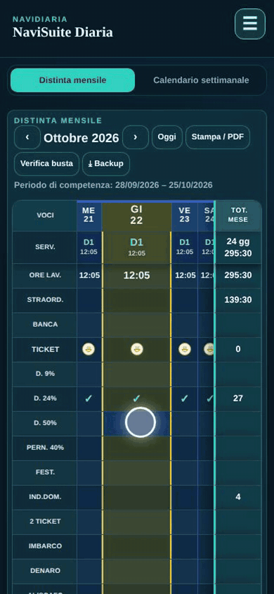

# Modificare una giornata nella Distinta

1. **Tocca il giorno da modificare** nella Distinta mensile: si apre la scheda della giornata.
2. **Tocca la voce da cambiare** (es. Ritardo, Cambio, Banca ore, Ticket, Diaria…).
3. **Scrivi il nuovo valore**: straordinari e ore lavorate si ricalcolano da soli.
4. **Tocca una bolla per cambiarne il contenuto** (Ticket usato/non usato, Diaria, Pernotto, Festività, 2° ticket, Imbarco…).
5. **Chiudi con la ✕**: la giornata è salvata e il foglio si aggiorna.

Per una giornata passata, alla chiusura NaviSuite chiede conferma prima di salvare.

Video: [guida-distinta.mp4](guida-distinta.mp4) · Passi: 
