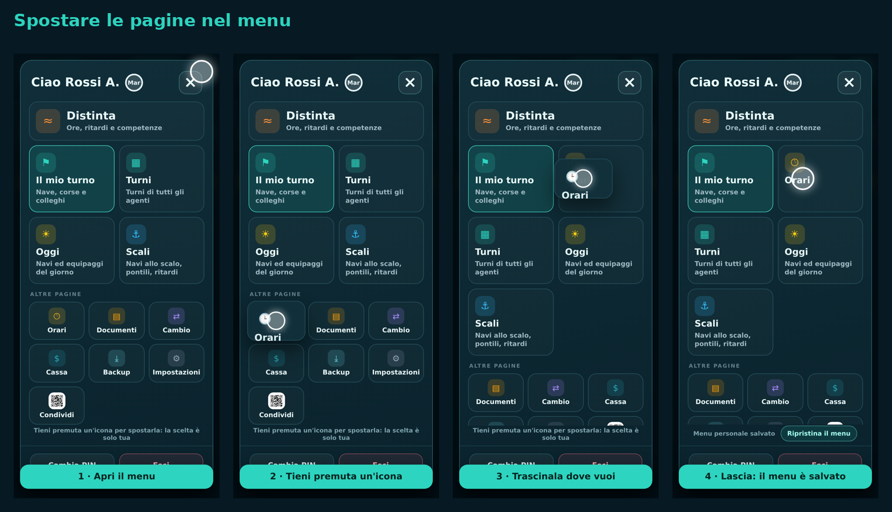

# Spostare le pagine nel menu

Video: [guida-menu.mp4](guida-menu.mp4)

1. **Apri il menu** con il pulsante ☰ in alto a destra.
2. **Tieni premuta un'icona** per mezzo secondo, finché si stacca dal menu.
3. **Trascinala dove vuoi**: tra le pagine principali in alto o tra le «Altre pagine», prima o dopo un'altra icona.
4. **Lascia il dito**: il menu è salvato («Menu personale salvato»).

- **Agenti**: lo spostamento vale solo per te. Con «Ripristina il menu» torni al menu deciso dagli amministratori.
- **Amministratori**: lo spostamento è il menu di tutti; «Imposta per tutti» azzera anche le scelte personali degli agenti.
- Su NaviBeta lo spostamento resta solo sul telefono (sola lettura).
